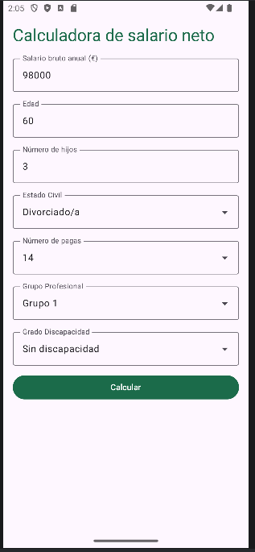

# Calculadora de salario neto

Actividad 1 · Programación Multimedia y Dispositivos Móviles

**Autora**: Patricia Rosalina Alonso Marañón

**Fecha**: 15/11/2026

## Descripción

* **Formulario interactivo de datos:** Recoge la información laboral y personal del usuario mediante campos numéricos y menús desplegables (Salario bruto anual, edad, número de hijos, estado civil, número de pagas, grupo profesional y grado de discapacidad).
* **Motor de cálculo fiscal (IRPF y Seguridad Social):**
    * Descuenta automáticamente la cotización a la Seguridad Social y los gastos deducibles generales.
    * Calcula el **mínimo personal y familiar** sumando al mínimo general las reducciones por edad, número de hijos y grado de discapacidad .
    * Aplica la **escala progresiva por tramos del IRPF** tanto a la base liquidable como al mínimo personal para obtener la retención real.
* **Desglose detallado de resultados:** Muestra en tarjetas diferenciadas el paso del bruto al neto (anual y por paga), el importe de las deducciones aplicadas y el **tipo efectivo de retención (%)**.

## Capturas

| Pantalla 1: datos | Pantalla 2: resultados |
| --- | --- |
|  |  |

## Tecnologías

- Kotlin y Jetpack Compose (Material 3)
- Navigation Compose 2.9.0 para la navegación entre panatellas
- Android Studio, Gradle (Kotlin DSL) y emulador Android
- `minSdk` 24 (Android 7) · `targetSdk` 37

## Cómo ejecutarlo

1. Clonar el repositorio y abrir la carpeta con Android Studio.
2. Esperar a que termine la sincronización de Gradle.
3. Elegir un emulador (o un móvil con depuración USB) y pulsar ▶ Run.

## Estructura del proyecto

```
app/src/main/java/com/rosalina/calculadorasalarioneto/
├── MainActivity.kt          Punto de entrada: tema + navegación
└── ui/
    ├── AppNavigation.kt     Rutas entre pantallas y estado compartido
    ├── DatosFormulario.kt   Datos introducidos por el usuario
    ├── FormularioScreen.kt  Vista 1: formulario de entrada
    ├── ResultadosScreen.kt  Vista 2: resultados
    ├── CalculoSalario.kt    Lógica del cálculo (IRPF, Seguridad Social)
    └── theme/               Colores, tipografía y tema
```

## Cómo funciona

1. Introduce tu **salario bruto anual**, **edad** y **número de hijos**.
2. Selecciona tus opciones en los desplegables de **estado civil**, **número de pagas** (12 o 14), **grupo profesional** y **grado de discapacidad**.
3. Pulsa el botón **"Calcular"** para navegar a la pantalla de resultados y consultar tu sueldo neto anual, el neto por paga y el desglose de impuestos.
4. Pulsa **"Volver"** si deseas modificar algún parámetro y recalcular al instante.

## Modelo de cálculo (simulado)

El cálculo es una **simulación orientativa**, no asesoramiento fiscal.

| Parámetro | Valor usado |
| --- | --- |
| Seguridad Social del trabajador | 6,48 % del bruto |
| Gastos deducibles | 2.000 € |
| Escala del IRPF | Tramos combinados (estatal + autonómico): 19 %, 24 %, 30 %, 37 %, 45 %, 47 % |
| Mínimo personal | 5.550 € |
| Mínimo por hijos | 2.400 / 2.700 / 4.000 / 4.500 € (1.º, 2.º, 3.º, 4.º y siguientes) |
| Mínimo por edad | +1.150 € (más de 65 años) y +1.400 € más (más de 75) |
| Mínimo por discapacidad | 3.000 € (33-64 %) · 9.000 € (65 % o más) |

**Limitaciones:** Aunque en el formulario se pide el estado civil y el grupo profesional, estos dos
datos no se han tenido en cuenta en el calculo. Esto es, no se aplica el tope de la base de cotización
ni las reglas autonómicas.

## Lo que he aprendido

- **Estructura de un proyecto Android:** `MainActivity` es el punto de entrada; con
  `setContent` carga la interfaz en Compose y arranca la navegación. El Manifest la
  declara como pantalla inicial y Gradle define el `applicationId`, el `minSdk` y las
  dependencias.
- **Funciones composables:** cada pantalla es una función de Kotlin marcada con
  `@Composable`. El plugin de Compose, activado desde Gradle, hace que la interfaz se
  redibuje sola cuando cambia el estado. He reutilizado funciones (`CampoNumerico`,
  `CampoDesplegable`, `FilaResultado`) para no repetir código.
- **Estado y navegación:** el estado del formulario vive en `AppNavigation` (*state
  hoisting*) y se pasa a las dos pantallas; así no se pierde al navegar y la vista 2
  puede leerlo. La navegación usa `NavHost` con rutas.
- **Kotlin:** se parece a Java porque comparten máquina virtual, pero es más conciso
  (inferencia de tipos, `data class`, `when`, tipos que admiten `null`) y comparte
  ideas con Python, como las plantillas de texto o los parámetros con nombre.
- **Cálculo por tramos:** cada tramo del IRPF se aplica solo a la parte de los ingresos
  que cae en él, y el mínimo personal y familiar se resta con la misma escala.

## Fuentes

- Enunciado de la actividad y tabla de IRPF 2024 (blog de Bankinter) indicada en él.